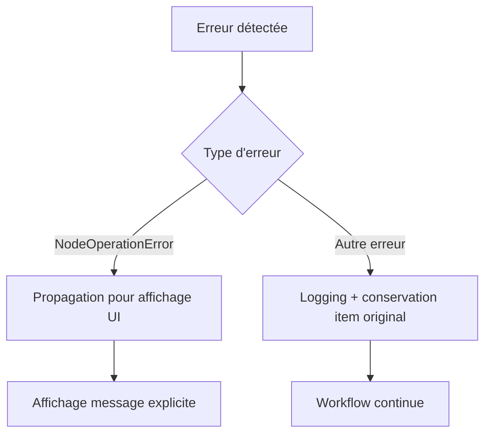

# Module FormatTemplate – Documentation technique complète

## Vue d'ensemble

Le module `FormatTemplate` est un node n8n avancé conçu pour transformer et formater dynamiquement des champs de données dans les workflows d'automatisation. Il s'appuie sur une architecture modulaire extensible utilisant des handlers spécialisés pour appliquer des règles de transformation (formatage de téléphone, conversion de pays, casse de texte, etc.).

## Architecture du système

### Composants principaux

#### 1. FormatTemplate.node.ts - Node principal
**Responsabilité** : Point d'entrée n8n, orchestration des transformations

**Fonctionnalités clés** :
- **Interface dynamique** : Génération automatique de l'UI basée sur les handlers disponibles
- **Validation des chemins** : Contrôle du format des chemins de propriétés (`^[a-zA-Z_][a-zA-Z0-9_.]*$`)
- **Gestion des données imbriquées** : Support des structures complexes via `getProp()` et `setProp()`
- **Traitement en lot** : Gestion de datasets volumineux avec stratégie de résilience
- **Clonage sécurisé** : Évite les références partagées entre items

**Méthodes principales** :
```typescript
async execute(): Promise<INodeExecutionData[][]>
generateDynamicProperties(): INodeProperties[]
validateFieldPath(fieldPath: string): void
```

#### 2. TransformHandlerRegistry.ts - Registre centralisé
**Responsabilité** : Gestion centralisée des transformations disponibles

**Fonctionnalités clés** :
- **Enregistrement automatique** : Les handlers sont découverts et enregistrés au démarrage
- **Génération d'options UI** : Création dynamique des sélecteurs de type
- **Accès uniforme** : Interface unique pour récupérer les handlers
- **Initialisation sécurisée** : Pattern singleton avec initialisation conditionnelle

**Méthodes statiques** :
```typescript
static initialize(): void
static register(handler: ITransformHandler): void
static getHandler(type: string): ITransformHandler | undefined
static getTypeOptions(): INodePropertyOptions[]
```

#### 3. AutoDiscovery.ts - Découverte automatique
**Responsabilité** : Chargement automatique des handlers depuis le système de fichiers

**Fonctionnalités clés** :
- **Scan automatique** : Parcours du dossier `handlers/` au démarrage
- **Validation d'interface** : Vérification que les classes implémentent `ITransformHandler`
- **Gestion d'erreurs** : Logging des erreurs de chargement sans crash
- **Support multi-extensions** : Support des fichiers `.ts`, `.js` (filtrage des `.d.ts`)

**Logique de découverte** :
```typescript
static loadHandlersFromDirectory(dirPath: string = path.join(__dirname, 'handlers')): void
private static isTransformHandler(obj: any): obj is ITransformHandler
```

#### 4. ITransformHandler - Interface standardisée
**Responsabilité** : Contrat standardisé pour tous les handlers

**Propriétés requises** :
- `type: string` - Identifiant unique (ex: 'phone', 'textCase')
- `displayName: string` - Nom affiché dans l'UI
- `description: string` - Description fonctionnelle
- `properties: INodeProperties[]` - Configuration UI spécifique
- `transform(): Promise<string>` - Méthode de transformation principale

### Flux d'exécution

#### 1. Initialisation
```mermaid
graph TD
    A[Démarrage n8n] --> B[TransformHandlerRegistry.initialize()]
    B --> C[AutoDiscovery.loadHandlersFromDirectory()]
    C --> D[Scan du dossier handlers/]
    D --> E[Validation ITransformHandler]
    E --> F[Enregistrement dans le Registry]
    F --> G[Génération des options UI]
```

#### 2. Exécution d'un workflow
```mermaid
graph TD
    A[Entrée de données] --> B[FormatTemplate.execute()]
    B --> C[Pour chaque item]
    C --> D[Clone de l'item]
    D --> E[Pour chaque champ configuré]
    E --> F[Validation du chemin]
    F --> G[Récupération de la valeur]
    G --> H[Sélection du handler]
    H --> I[Transformation via handler]
    I --> J[Mise à jour de la valeur]
    J --> K[Retour des données transformées]
```

#### 3. Gestion des erreurs


## Handlers implémentés

### 1. TextCaseHandler - Transformation de casse

**Type** : `textCase`  
**Fichier** : `handlers/TextCaseHandler.ts`

**Fonctionnalités** :
- **Majuscules** : `toLocaleUpperCase('fr-FR')` - Support des caractères français
- **Minuscules** : `toLocaleLowerCase('fr-FR')` - Gestion des accents
- **Capitalisation** : Première lettre en majuscule, reste en minuscules

**Configuration UI** :
```typescript
{
  displayName: 'Case',
  name: 'textCase',
  type: 'options',
  options: [
    { name: 'UPPERCASE', value: 'uppercase' },
    { name: 'Lowercase', value: 'lowercase' },
    { name: 'Capitalize', value: 'capitalize' },
  ]
}
```

**Cas d'usage** :
- Standardisation des noms de clients
- Normalisation des codes de référence
- Harmonisation des données importées

### 2. PhoneHandler - Formatage des téléphones

**Type** : `phone`  
**Fichier** : `handlers/PhoneHandler.ts`

**Algorithme de transformation** :
1. **Nettoyage du pattern** : Suppression des accolades `{0:...}`
2. **Extraction des chiffres** : Suppression de tous caractères non-numériques
3. **Conversion internationale** : Gestion des préfixes 0033/33 vers format national
4. **Application du pattern** : Remplacement caractère par caractère

**Patterns supportés** :
- `{0:+33 (0) # ## ## ## ##}` - Format français international
- `{0:0# ## ## ## ##}` - Format français national
- `{0:(###) ###-####}` - Format américain
- Patterns personnalisés avec `#` (optionnel) et `0` (littéral)

**Logique de conversion** :
```typescript
// Conversion automatique international → national pour patterns français
if ((digits.startsWith('0033') || digits.startsWith('33')) && cleanPattern.startsWith('0')) {
    digits = digits.startsWith('0033') ? '0' + digits.substring(4) : '0' + digits.substring(2);
}
```

### 3. CountryHandler - Codes pays ISO2

**Type** : `country`  
**Fichier** : `handlers/CountryHandler.ts`

**Fonctionnalités** :
- **Validation codes existants** : Vérification format ISO2 (`/^[A-Z]{2}$/i`)
- **Conversion nom → code** : Via API REST Countries
- **Support multilingue** : Noms de pays en différentes langues
- **Gestion d'erreurs** : Messages explicites pour pays non trouvés

**API externe** :
```typescript
const options: IHttpRequestOptions = {
  method: 'GET',
  url: `https://restcountries.com/v3.1/name/${encodeURIComponent(value)}`,
  qs: { fields: 'cca2' },
  json: true,
};
```

**Gestion d'erreurs** :
- Utilisation de `NodeOperationError` pour affichage dans l'UI
- Messages d'erreur localisés en français
- Fallback gracieux en cas d'API indisponible

## Gestion des données

### Manipulation des propriétés imbriquées

Le système utilise des fonctions utilitaires pour gérer les structures complexes :

#### getProp() - Lecture sécurisée
```typescript
function getProp(obj: IDataObject, path: string): any {
  return path.split('.').reduce((o: any, key) => (o ? (o as any)[key] : undefined), obj);
}
```

#### setProp() - Écriture avec création automatique
```typescript
function setProp(obj: IDataObject, path: string, value: unknown): void {
  const parts = path.split('.');
  let cur: IDataObject = obj;
  
  // Navigation jusqu'au parent
  for (let i = 0; i < parts.length - 1; i++) {
    const p = parts[i];
    if (cur[p] === undefined) {
      cur[p] = {} as IDataObject;
    } else if (typeof cur[p] !== 'object') {
      cur[p] = {} as IDataObject;
    }
    cur = cur[p] as IDataObject;
  }
  
  // Assignation avec conversion de type
  const lastPart = parts[parts.length - 1];
  (cur as any)[lastPart] = value;
}
```

### Validation des chemins

**Expression régulière** : `^[a-zA-Z_][a-zA-Z0-9_.]*$`

**Règles** :
- Doit commencer par une lettre ou underscore
- Peut contenir lettres, chiffres, underscores et points
- Exemples valides : `phone`, `client.name`, `data_field`, `item.sub_property`
- Exemples invalides : `123field`, `field-name`, `field with spaces`

### Stratégie de résilience

**Principes** :
- **Isolation des erreurs** : Chaque item est traité indépendamment
- **Préservation des données** : En cas d'erreur, l'item original est conservé
- **Logging détaillé** : Tous les échecs sont loggés pour débogage
- **Continuité du workflow** : Une erreur n'arrête pas le traitement des autres items

## Extension du système

### Création d'un nouveau handler

#### 1. Structure de base
```typescript
import { ITransformHandler } from '../interfaces/TransformHandler';
import { INodeProperties, IExecuteFunctions } from 'n8n-workflow';

export class CustomHandler implements ITransformHandler {
  type = 'custom';
  displayName = 'Custom Transform';
  description = 'Description de votre transformation';

  properties: INodeProperties[] = [
    {
      displayName: 'Option',
      name: 'customOption',
      type: 'string',
      default: '',
      description: 'Description de l'option',
    },
  ];

  async transform(
    executionContext: IExecuteFunctions,
    value: string,
    params: Record<string, any>
  ): Promise<string> {
    // Logique de transformation
    const option = params.customOption as string;
    return this.processValue(value, option);
  }

  private processValue(value: string, option: string): string {
    // Implémentation de la transformation
    return value;
  }
}
```

#### 2. Types de propriétés UI supportés

**Options simples** :
```typescript
{
  displayName: 'Mode',
  name: 'mode',
  type: 'options',
  options: [
    { name: 'Mode A', value: 'a' },
    { name: 'Mode B', value: 'b' },
  ]
}
```

**Chaînes personnalisées** :
```typescript
{
  displayName: 'Pattern',
  name: 'pattern',
  type: 'string',
  typeOptions: {
    allowCustomValues: true,
  }
}
```

**Affichage conditionnel** :
```typescript
{
  displayName: 'Advanced Option',
  name: 'advancedOption',
  type: 'string',
  displayOptions: {
    show: {
      mode: ['advanced'],
    },
  }
}
```

#### 3. Bonnes pratiques de développement

**Validation d'entrée** :
```typescript
async transform(context: IExecuteFunctions, value: string, params: Record<string, any>): Promise<string> {
  if (!value || typeof value !== 'string') {
    return value; // Retour sécurisé
  }
  
  const option = params.customOption as string;
  if (!option) {
    console.warn(`[CustomHandler] Option manquante, utilisation de la valeur par défaut`);
    // Logique de fallback
  }
  
  try {
    return this.processValue(value, option);
  } catch (error) {
    console.error(`[CustomHandler] Erreur de transformation:`, error);
    throw new NodeOperationError(
      context.getNode(),
      `Impossible de transformer "${value}": ${error.message}`
    );
  }
}
```

**Gestion des erreurs** :
```typescript
import { NodeOperationError } from 'n8n-workflow';

// Pour les erreurs utilisateur (affichage dans l'UI)
throw new NodeOperationError(
  executionContext.getNode(),
  `Message d'erreur explicite pour l'utilisateur`
);

// Pour les warnings (logging uniquement)
console.warn(`[HandlerName] Situation non critique`);
```

**Tests unitaires** :
```typescript
describe('CustomHandler', () => {
  let handler: CustomHandler;
  let mockContext: IExecuteFunctions;

  beforeEach(() => {
    handler = new CustomHandler();
    mockContext = createMockExecutionContext();
  });

  it('should transform value correctly', async () => {
    const result = await handler.transform(
      mockContext,
      'input value',
      { customOption: 'test' }
    );
    expect(result).toBe('expected output');
  });

  it('should handle invalid input gracefully', async () => {
    const result = await handler.transform(mockContext, '', {});
    expect(result).toBe('');
  });
});
```

## Performance et optimisation

### Métriques de performance

**Objectifs** :
- Temps de traitement < 100ms par item pour les transformations simples
- Support de datasets de 1000+ items sans dégradation significative
- Utilisation mémoire optimisée via clonage sélectif

**Optimisations implémentées** :
- **Clonage JSON intelligent** : Seules les parties modifiées sont clonées
- **Registry en cache** : Les handlers sont instanciés une seule fois
- **Validation précoce** : Échec rapide pour les configurations invalides

### Logging et débogage

**Niveaux de logging** :
```typescript
console.log(`[FormatTemplate] Processing item ${itemIndex}, fields: ${fields.length}`);
console.log(`[HandlerName] Current value: ${currentValue}`);
console.log(`[HandlerName] Transformed to: ${newValue}`);
console.error(`[HandlerName] Error:`, error);
```

**Points de contrôle** :
- Démarrage du traitement
- Transformation de chaque champ
- Résultat final par item
- Erreurs et exceptions

## Conclusion

Le module FormatTemplate représente une solution robuste et extensible pour la transformation de données dans l'écosystème n8n. Son architecture modulaire, basée sur le pattern Registry et la découverte automatique, permet une maintenance facilitée et une évolution continue selon les besoins des utilisateurs.

La conception orientée handlers garantit une séparation claire des responsabilités tout en offrant une expérience utilisateur cohérente et intuitive. Cette approche favorise la contribution communautaire et assure la pérennité du produit.
