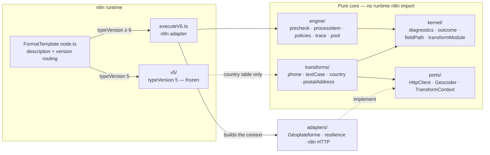
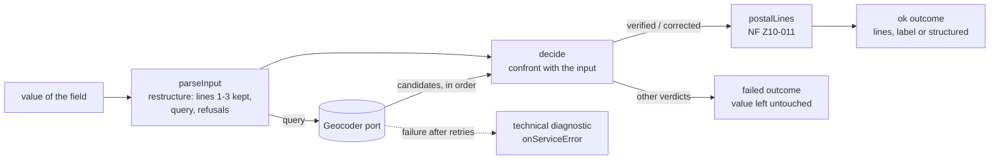
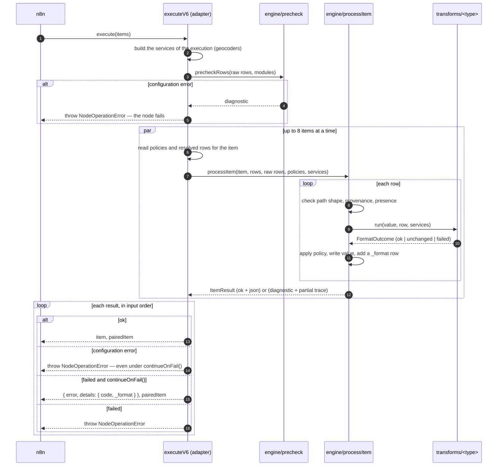

# Architecture

This document describes the **inside** of the node: its layers, how an execution flows
through them, the contracts between them, and the rules that keep them apart. The *why*
of each choice is in the [decision records](adr/README.md); the parameters are in the
[parameter matrix](PARAMETERS.md); the codes in the [diagnostics catalogue](DIAGNOSTICS.md).

## Overview



The engine calls the transformations through the module list it is given; it imports
neither them nor the ports. Only the composition roots — `FormatTemplate.node.ts` and
`executeV6.ts` — see every layer.

| Layer | Responsibility | Depends on |
|---|---|---|
| `kernel/` | The contracts every other layer speaks: diagnostics and their codes, the typed outcome of a transform, field paths, the `TransformModule` contract | nothing |
| `engine/` | Everything typeVersion 6 decides: configuration check, per-item processing, policies, `_format` trace, the item pool | `kernel/` |
| `transforms/<type>/` | One vertical slice per transformation: interface, pure function, codes, configuration check | `kernel/`, `ports/`, another slice's pure tables |
| `ports/` | Interfaces a transformation needs from the outside world — `HttpClient`, `Geocoder`, `TransformContext` — and their typed failures; no implementation | nothing |
| `adapters/` | Implementations of the ports: the Géoplateforme geocoder, the resilience decorators, the HTTP client on n8n's helper — the **only** network access point ([ADR-0015](adr/0015-network-behind-one-adapter.md)) | `ports/` |
| `executeV6.ts` | The n8n adapter: reads parameters, builds the services of the execution, hands items to the engine, writes n8n output | everything above, `n8n-workflow` |
| `v5/` | typeVersion 5, frozen by characterization tests ([ADR-0004](adr/0004-no-retroactive-change.md)) | the country table |

`n8n-workflow` is imported **as a type only** in the pure layers (`kernel/`, `engine/`,
`ports/`, `transforms/`): the type declarations are erased at compile time, so those
layers run — and are tested — without n8n. The direction of the arrows is checked by
AR-10: the kernel and the engine know no port, and an adapter knows nothing but the
ports.

### A transformation backed by a service: `postalAddress`

`transforms/postalAddress/` checks a French postal address against the national address
base and writes it to the postal standard
([ADR-0013](adr/0013-address-verdict-confronts-the-answer.md),
[ADR-0014](adr/0014-postal-lines-to-the-standard.md); user guide:
[postal-address.md](transforms/postal-address.md)). Its core is pure — reading the input,
the verdict, the lines; it reaches the service through the `Geocoder` port only, which
`executeV6.ts` builds from the adapters
([ADR-0015](adr/0015-network-behind-one-adapter.md)).



Behind the port, one stack per service configuration and per execution, composed in
`adapters/geocoding.ts`:


Each decorator implements `Geocoder` and wraps another one, so each is tested alone on a
simulated clock. A failure the stack cannot absorb comes back as a `GeocoderError` —
`unavailable`, `rate_limited` or `rejected` — which the module turns into a **technical**
diagnostic: the engine applies `onServiceError` to it, never `onFieldError`.

## Folder layout

```text
FormatTemplate/
├── FormatTemplate.node.ts      assembles the description, routes on typeVersion
├── FormatTemplate.node.json    n8n codex (category, aliases, documentation link)
├── FormatTemplate.svg          icon, light theme (Lucide `wand-sparkles`, ISC)
├── FormatTemplate.dark.svg     icon, dark theme
├── executeV6.ts                n8n adapter of typeVersion 6
├── kernel/
│   ├── diagnostics.ts          FT_* codes, diagnostic factory, configuration vs data
│   ├── outcome.ts              FormatOutcome: ok | unchanged | failed
│   ├── fieldPath.ts            shape, read, write and provenance of a path
│   └── transformModule.ts      TransformModule contract, scopeToTransform
├── engine/
│   ├── precheck.ts             configuration errors, before the loop
│   ├── processItem.ts          one item: rows, policies, verdict
│   ├── policies.ts             onFieldError, onMissingField, onServiceError, options
│   ├── trace.ts                _format and metadata.messageHistory
│   └── pool.ts                 bounded concurrency, results in input order
├── transforms/
│   ├── index.ts                constant, ordered list of modules
│   ├── phone/                  module · properties · format · read · render · plans ·
│   │                           patterns · planTypes · numberingPlans (generated)
│   ├── textCase/               module · properties · format
│   ├── country/                module · properties · format · countryCodes (generated)
│   └── postalAddress/          module · properties · params · codes · text · vocabulary ·
│                               parseInput · similarity · decide · postalLines · evaluate
├── ports/
│   ├── httpClient.ts           HttpClient, HttpTransportError
│   ├── geocoder.ts             Geocoder, AddressCandidate, GeocoderError, GeocoderSettings
│   └── transformContext.ts     services offered to the transformations of an execution
├── adapters/
│   ├── geocoding.ts            one geocoder stack per configuration and per execution
│   ├── geoplateforme/
│   │   ├── mapResponse.ts      Géoplateforme answer → AddressCandidate[] (pure)
│   │   └── geocoder.ts         the request, the status → failure mapping, Retry-After
│   ├── resilience/
│   │   ├── scheduler.ts        clock, sleep and randomness — simulated in tests
│   │   ├── retry.ts            retries with backoff, jitter and Retry-After
│   │   ├── rateLimit.ts        spacing of request starts
│   │   └── cache.ts            cache of one execution, requests in flight shared
│   └── n8n/
│       └── httpClient.ts       HttpClient on helpers.httpRequest — the network access point
├── v5/
│   ├── executeLegacy.ts        typeVersion 5 loop — frozen
│   └── legacyTransforms.ts     typeVersion 5 transformations — frozen
├── scripts/                    development only, neither compiled nor shipped
│   ├── gen_country_table.js    regenerates the country table
│   ├── gen_phone_plans.js      regenerates the numbering plans from pinned libphonenumber metadata
│   └── record-ban-fixtures.js  records the geocoder answers of the address corpus
├── docs/                       this documentation
└── __tests__/                  unit, engine, architecture and description tests
```

## How an execution flows



1. **Configuration check** — before touching any item, `precheckRows` checks the literal
   values of every row: path shape, `outputPath`, known type, and each module's
   `validateRow` (the phone mask, the geocoding service URL). A configuration error fails
   the node ([ADR-0001](adr/0001-one-item-one-decision.md)).
2. **Per item** — the adapter reads the rows and policies **resolved for that item** (n8n
   expressions may differ per item) and the **raw** rows (to see that a path came from an
   expression).
3. **Per row** — the engine checks the path shape (configuration), its provenance
   (`FT_PATH_FROM_EXPRESSION`), its presence (`onMissingField`), calls the transform, then
   applies the policy of the failure's class: `onServiceError` to a technical failure,
   `onFieldError` to a data failure. The value is written only on `ok`
   ([ADR-0002](adr/0002-never-approximate.md)), at `outputPath` when the row sets one.
4. **Result** — the engine returns a result instead of throwing; the adapter alone turns a
   diagnostic into a `NodeOperationError` and shapes the error-output item
   ([ADR-0011](adr/0011-error-output-item-shape.md)). A configuration error fails the node
   even under `continueOnFail()`; a service failure, like a data failure, becomes an error
   item there — thrown under *Continue*, it would be swallowed by n8n, which passes the input
   items through unchanged ([ADR-0015](adr/0015-network-behind-one-adapter.md)).
5. **Concurrency** — items are processed eight at a time, because a transformation may
   wait on a service; the results are written out in input order, each with its
   `pairedItem`. The services of the execution (one cache, one rate per configuration)
   are shared by all items ([ADR-0015](adr/0015-network-behind-one-adapter.md)).

The item is deep-cloned (`json` and `binary`) before any write: the input item is never
mutated.

## Contracts

### `TransformModule`

```ts
interface TransformModule<Context = unknown> {
  readonly type: string;                         // stable id, written into workflows
  readonly displayName: string;
  readonly description: string;
  readonly properties: readonly INodeProperties[]; // without the `type` condition
  readonly codes: readonly string[];             // FT_* codes it may emit
  validateRow?(row): FtDiagnostic | undefined;   // configuration check, before the loop
  run(value, params, context: Context): FormatOutcome | Promise<FormatOutcome>;
}
```

- `properties` are declared **without** `displayOptions.show.type`: `scopeToTransform`
  adds it, so a module cannot show its parameters on another type's rows. The `@version`
  condition is declared by the module, which knows where each parameter exists.
- `run` receives the value **unconverted** and returns a typed outcome; it does not throw.
  The engine catches anything thrown anyway and turns it into `FT_INTERNAL_ERROR`
  ([ADR-0007](adr/0007-pure-transforms.md)).
- `run` may return a promise, and receives the services of the execution as `context`
  — a `TransformContext` for the node's modules, bound in `transforms/index.ts`. The
  kernel and the engine stay generic: they pass the context through without knowing it
  (AR-10). A transformation that needs no service ignores it.

### `FormatOutcome`

| Status | Meaning | Value written |
|---|---|---|
| `ok` | transformed | yes — `value` |
| `unchanged` | nothing to do (empty, already normalized) | no — the original stays |
| `failed` | cannot apply | no — the original stays; `onFieldError` decides the item's fate |

Each outcome carries diagnostics, warnings included on a success.

### Output of an item

- `_format` — the trace: `{ status: 'ok' | 'partial' | 'failed', fields: [...] }`, one row
  per configured field with `path`, `target` (when the row writes to an `outputPath`),
  `type`, `status` (`ok`, `unchanged`, `skipped`, `failed`), `code`, `message`, and
  `before`/`after` only under `options.traceValues`
  ([ADR-0006](adr/0006-no-personal-data-in-diagnostics.md)).
- `metadata.messageHistory` — one entry appended per execution of the node (`nodeName`,
  `nodeType`, `timestamp`, `executionId`, `status`, and `validationErrors` when the item is
  not `ok`), the convention of Enterprise Integration Pattern pipelines.
- Both are written only when `options.enrichMetadata` is on (the default).
- On the error output: see [ADR-0011](adr/0011-error-output-item-shape.md) — the trace is
  under `details._format`.

## The description is assembled, and frozen

`FormatTemplate.node.ts` builds the `fieldsToFormat.field` collection from `fieldPath`,
`type` (whose options come from the module list), then each module's `properties`, then
appends the node-level policies (`engine/policies.ts`).

`__tests__/fixtures/description.json` holds the complete expected description, and
DESC-01 compares the assembly to it. An intended interface change updates the fixture in
the same commit: its diff is the review of the interface.

## Rules and the tests that enforce them

| Rule | Test |
|---|---|
| The pure layers import `n8n-workflow` as a type only | AR-01 |
| Only `adapters/n8n/` may open a network connection | AR-02 (and CO-04: the country slice and typeVersion 5 stay offline) |
| Each layer imports only the layers it may: the kernel and the engine know no port, an adapter knows only the ports | AR-10 |
| No import leaves the folder, tests included | AR-03 |
| Shipped code imports no package other than `n8n-workflow` | AR-03 |
| Shipped code reads neither environment variables nor files | AR-04 |
| `country` depends on nothing but the kernel — it stays offline | AR-05 |
| Every `transforms/` folder with a `module.ts` is a registered module, and vice versa; module codes exist | AR-06 |
| A slice without a `module.ts` is inert: no shipped file outside it imports it | AR-06 |
| Every diagnostic code is documented | AR-06 (`publication.test.ts`) |
| Every parameter is in the matrix with an existing proving test | AR-07 |
| The published folder carries no internal reference | AR-08 |
| The assembled description matches the fixture | DESC-01, DESC-02 |

AR-01 to AR-06 and AR-10 read the sources rather than a simulated context, so they also
cover files nobody has written yet. Each was seen red on a planted violation.

## Extending the node

Adding a transformation `myType`:

1. Create `transforms/myType/` on the model of `textCase/`:
   - `format.ts` — the **pure** function: returns a `FormatOutcome`, never throws, never
     writes the processed value in a message;
   - `properties.ts` — its parameters, **without** a `type` condition, with
     `displayOptions: { show: { '@version': [6] } }`;
   - `module.ts` — the `TransformModule`: `type`, `displayName`, `description`,
     `properties`, `codes`, `run`, and `validateRow` if a setting can be judged before the
     loop.
2. Add its codes to `FT_CODES` in `kernel/diagnostics.ts` — they are part of the public
   contract — and, if they denote a configuration error, to `CONFIGURATION_CODES`.
3. Register the module in `TRANSFORM_MODULES` (`transforms/index.ts`), at the place it
   should take in the dropdown. AR-06 fails on an unregistered folder.
4. Regenerate `__tests__/fixtures/description.json` and review its diff (DESC-01).
5. Document it: a page in `docs/transforms/`, its codes in [DIAGNOSTICS.md](DIAGNOSTICS.md)
   (AR-06), one row per parameter in [PARAMETERS.md](PARAMETERS.md) with the test that
   proves it (AR-07).

Adding a parameter to an existing transformation follows steps 4 and 5.

A transformation that needs a service adds, before step 1:

- a **port** in `ports/` — the interface it needs, in its own terms, with typed failures;
- an **adapter** in `adapters/` that implements it on `HttpClient`, wrapped in the
  resilience decorators it needs;
- a method of `TransformContext`, built in `executeV6.ts`.

Its failures that are not about the data get codes of their own, in `TECHNICAL_CODES`:
they follow `onServiceError` ([ADR-0015](adr/0015-network-behind-one-adapter.md)).

## Testing strategy

| Level | What | How |
|---|---|---|
| Pure functions | each transform, field paths | direct calls, no n8n context |
| Engine through the node | policies, `continueOnFail`, `pairedItem`, trace, error item | the node's `execute` on a minimal simulated n8n context (`__tests__/helpers/mockExecute.ts`) |
| typeVersion 5 | its exact historical behaviour | characterization tests, values measured on a real instance |
| Architecture | the rules above | source reading |
| Interface | the description | frozen fixture |
| Postal-address verdict | 55 real inputs and the verdict a human gives | geocoder answers recorded once (`scripts/record-ban-fixtures.js`), replayed offline; thresholds swept over the corpus ([ADR-0013](adr/0013-address-verdict-confronts-the-answer.md)) |
| Adapters | the request, status mapping, retry, rate limit, cache, pool | a fake `HttpClient` and a simulated clock — no real wait, no network |
| Postal address through the node | the whole stack, from `helpers.httpRequest` to `_format` | the simulated n8n context serves the recorded answers, or a scripted outage (`429`, `400`, refused connection) |
| n8n engine behaviour | error-output routing, expressions | acceptance runs on a real n8n instance — a simulated context cannot show them ([ADR-0011](adr/0011-error-output-item-shape.md)) |

Run them with:

```bash
npx jest nodes/FormatTemplate
```
